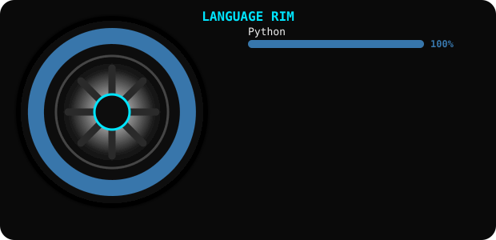
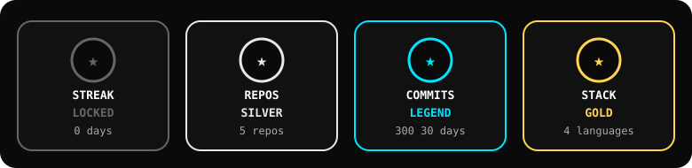

<!-- ==================== ANIME GIF BANNER ==================== -->

  

<!-- ==================== ANIMATED NAME / AIM ==================== -->

  

<!-- ==================== ANIMATED TAGLINE ==================== -->

  

---
<!-- ==================== GARAGE STATS (Streak + Contributions) ==================== -->
<h2 align="center">🏁 Garage Stats</h2>

  

<!-- ==================== GITHUB STATS CARD ==================== -->

  

---

<!-- ==================== 3 SEPARATE SPEEDOMETERS ==================== -->
<h2 align="center">🚗 Live Activity Dashboard</h2>

  
  
  

---

<!-- ==================== ROTATING RIM + LANGUAGE CHART ==================== -->
<h2 align="center">⚙️ Spinning Language Rim</h2>

  

---

<!-- ==================== TECH STACK ==================== -->
<h2 align="center">💻 My Python Full Stack Garage</h2>

  

---

<!-- ==================== TROPHIES ==================== -->
<h2 align="center">🏆 Achievement Garage</h2>

  

---

<!-- ==================== CONTACT ==================== -->
<h2 align="center">📬 Connect With Me</h2>

  
  
  
  

  

