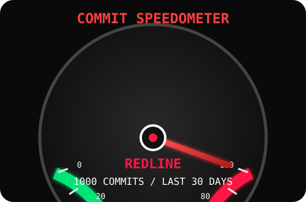

<!-- ==================== ANIME GIF BANNER ==================== -->

  

<!-- ==================== ANIMATED NAME / AIM ==================== -->

  

  <i>「 Code • Build • Learn • Repeat 」</i>

---

<!-- ==================== STATS + STREAK ==================== -->
<h2 align="center">🏁 Garage Stats</h2>

  
  

---

<!-- ==================== AUTO SPEEDOMETER ==================== -->
<h2 align="center">🚗 Commit Speedometer</h2>

  

---

<!-- ==================== AUTO JDM RIM LANGUAGE ANALYSIS ==================== -->
<h2 align="center">⚙️ JDM Rim — Language Analysis</h2>

  

---

<!-- ==================== TECH STACK ==================== -->
<h2 align="center">💻 My Python Full Stack Garage</h2>

  

---

<!-- ==================== TROPHIES ==================== -->
<h2 align="center">🏆 Achievement Garage</h2>

  

---

<!-- ==================== CONTACT ==================== -->
<h2 align="center">📬 Connect With Me</h2>

  
  
  
  

  

