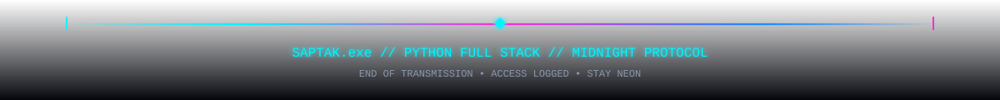

<div align="center">


<div align="center">

<br/>

[](https://saptak-chaki.github.io/saptak-exe-3d/)

<br/>
<sub>🚀 Click above to enter real-time 3D JDM Cyberpunk Midnight Protocol</sub>
<br/><br/>

</div>

# SAPTAK.exe
### Saptak Chaki
**Python Full Stack Developer**  
`3D JDM CYBERPUNK PROFILE`

IoT • Cyber Security • Blockchain


</div>

---

<div align="center">
  
</div>

---

## SYSTEM TERMINAL

```text
> boot SAPTAK.exe --mode=midnight
┌──────────────────────────────────────────────┐
│  DRIVER        : SAPTAK CHAKI                │
│  CLASS         : PYTHON FULL STACK           │
│  WORLD         : 3D JDM CYBERPUNK            │
│  VEHICLE       : SKYLINE GT-R R34            │
│  STATUS        : ONLINE                      │
│  ACCESS        : GRANTED                     │
│  MOTTO         : Code hard. Drive faster.    │
└──────────────────────────────────────────────┘
```
<div align="center">
Launch 3D

</div>
text

[ 3D WORLD ]  Neon Tokyo Expressway
[ CAR ]       Nissan Skyline GT-R R34
[ MODE ]      Real-time camera + road loop
TECH STACK
<div align="center">  </div>
PROJECT GARAGE
<div align="center"><a href="https://github.com/saptak-chaki/REPO_1">  </a><a href="https://github.com/saptak-chaki/REPO_2">  </a></div>
ENGINE IGNITION — STREAK
<div align="center">  </div>
CONTRIBUTION CIRCUIT
<div align="center">  </div>
GITHUB STATISTICS
<div align="center">   </div>
TROPHIES
<div align="center">  </div>
CONTACT
<div align="center">
GitHub
LinkedIn
Email

</div>
<div align="center">
SAPTAK.exe // 3D MIDNIGHT PROTOCOL // END OF TRANSMISSION

</div> 
